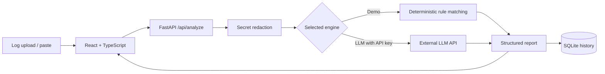

# PipelineLens — AI-Powered CI/CD Failure Analyzer

[](./.github/workflows/ci.yml) [](./backend/app/main.py) [](./frontend/src/App.tsx) [](./docker-compose.yml)

A full-stack portfolio project that analyzes CI/CD build logs, detects likely failure patterns, and suggests practical debugging steps. The app provides a **FastAPI / Python backend**, **SQLAlchemy + SQLite persistence**, a **React / TypeScript dashboard**, and a **GitHub Actions CI workflow**. It runs in an **offline demo mode without credentials** and optionally calls an LLM API for richer diagnostic hypotheses.

> **Transparency:** Demo mode is a rule-based diagnostic engine, **not AI**. LLM mode uses an actual external model only when you supply your own API key. Findings are hypotheses to verify—not definitive root-cause diagnoses. This repository is intended as a local demo/portfolio project; it is **not** production-ready or suitable for uploading confidential logs.

## Preview

The application is a responsive, dark-themed dashboard with an editable log input, file upload, analysis-engine switch, finding cards, recommendations, and persistent history. To see it, run the app and open <http://localhost:8080> (Docker) or <http://localhost:5173> (local development).

## Features

- Upload UTF-8 `.log` / `.txt` files or paste build logs (maximum 256 KiB).
- Rule-based failure detection for missing packages, dependency conflicts, test failures, Docker build errors, permissions, OOM terminations, networking, and lint errors.
- Optional LLM-based log analysis with structured diagnostic findings.
- API-powered React/TypeScript dashboard with evidence excerpts, severity tags, remediation suggestions, and recent history.
- Best-effort secret redaction before storage or third-party LLM submission.
- SQLAlchemy persistence backed by SQLite (database excluded from Git).
- Automated API tests using `pytest` / FastAPI TestClient.
- Docker-based local deployment (frontend served by Nginx; API proxied to backend).
- CI pipeline that runs backend tests, frontend TypeScript build, and Docker image builds.

## Tech stack

| Area | Technologies |
| --- | --- |
| Backend | Python, FastAPI, Pydantic, SQLAlchemy |
| Frontend | React, TypeScript, Vite, CSS |
| Database | SQLite |
| LLM (optional) | OpenAI API (configurable model) |
| DevOps | Docker, Docker Compose, Nginx, GitHub Actions |
| Testing | Pytest, FastAPI TestClient, TypeScript compilation |

## Quick start: Docker (recommended)

Requirements: Docker and Docker Compose plugin.

```bash
# Copy this repository locally, then from the project root:
cp .env.example .env
docker compose up --build
```

Open **http://localhost:8080**. The **Smart rules** mode works immediately—no API key required.

Stop with `Ctrl+C`, then:

```bash
docker compose down
```

To delete saved demo history as well, use `docker compose down -v` (**destructive**: erases the project's persistent database volume).

### Enable real LLM analysis (optional)

Edit `.env` in the repository root:

```dotenv
OPENAI_API_KEY=your_key_here
OPENAI_MODEL=gpt-4.1-mini
```

Then restart:

```bash
docker compose up --build
```

Switch the dashboard to **LLM analysis**. This sends a redacted excerpt of the supplied log to the configured AI provider and may incur API charges. **Use only logs you have permission to share**; regex redaction is not a guarantee that secrets or personal data will be removed. Do **not** commit `.env`.

The model identifier may need to be changed depending on your API account and model availability.

## Local development (without Docker)

Prerequisites: Python 3.12+ and Node.js 22+.

**Terminal 1 — backend:**

```bash
cd backend
python -m venv .venv
# macOS/Linux:
source .venv/bin/activate
# Windows PowerShell: .venv\Scripts\Activate.ps1
pip install -r requirements-dev.txt
uvicorn app.main:app --reload --port 8000
```

**Terminal 2 — frontend:**

```bash
cd frontend
npm install
npm run dev
```

Open **http://localhost:5173**. Vite forwards `/api` requests to the local backend at port `8000`.

For local LLM mode, export `OPENAI_API_KEY` in the **backend terminal** before starting Uvicorn. Never set API credentials in `VITE_*` environment variables or frontend source code.

## Test

```bash
cd backend
python -m pytest -q

cd ../frontend
npm install
npm run build
```

GitHub Actions runs these checks and builds Docker images on pushes and pull requests.

**Dependency note:** This source archive does not bundle `node_modules` or an npm lockfile. On your first install with network access, `npm install` creates `frontend/package-lock.json`. Review and commit that file to GitHub to make future installs reproducible, then you can switch CI/Docker to `npm ci`.

## Example API calls

Start the backend, then run:

```bash
curl http://localhost:8000/api/health
curl -X POST http://localhost:8000/api/analyze \
  -F 'mode=demo' \
  -F 'file=@sample-logs/python-test-failure.log'
curl http://localhost:8000/api/history
```

The upload path in the example assumes you run `curl` from the repository root. API docs: **http://localhost:8000/docs** during local development. In Docker Compose the API is accessible via Nginx at **http://localhost:8080/api/** (the backend's port is not published to the host).

### Example structured result

```json
{
  "summary": "Detected 2 possible failure pattern(s). Review evidence before applying fixes.",
  "findings": [
    {
      "category": "dependencies",
      "severity": "high",
      "title": "Missing module or dependency",
      "evidence": "ModuleNotFoundError: No module named 'requests'",
      "explanation": "A module could not be imported or located in the build environment.",
      "recommendations": ["Check dependency declarations and lockfiles."]
    }
  ],
  "next_steps": ["Validate the proposed change locally and rerun the pipeline."]
}
```

The actual API also returns an ID, date, mode, timing, and redacted excerpt, and may include additional findings and recommendations. This is a shortened illustrative response.

## Architecture



See [docs/architecture.md](docs/architecture.md) for implementation details and limitations.

## Repository structure

```text
ai-cicd-failure-analyzer/
├── .github/workflows/ci.yml   # Tests, TypeScript build, Docker builds
├── backend/
│   ├── app/                    # API, analyzers, database, redaction
│   ├── tests/                  # Unit tests and endpoint tests
│   ├── Dockerfile
│   └── requirements*.txt
├── frontend/
│   ├── src/                    # React app, API client, types and CSS
│   ├── Dockerfile
│   ├── nginx.conf
│   └── package.json
├── sample-logs/                # Safe, invented CI log examples
├── docs/architecture.md
├── docker-compose.yml
├── .env.example
└── README.md
```

## Security and privacy limitations

- This is a **local demonstration**, with **no user login, authorization, audit policy, retention controls, or production rate limiting**. Do not expose it as a public service as-is.
- The API saves a **redacted, truncated log excerpt** and structured findings to SQLite. It does not intentionally store the entire raw log. You are responsible for deleting the local database when appropriate.
- Regular expressions cannot catch every credential or personal identifier. Manually review logs before uploading them, particularly in LLM mode.
- The LLM receives only a redacted log excerpt. Treat logs as untrusted text; prompt injection is possible despite defensive instructions.
- Suggestions may be incorrect, unsafe, or incomplete; verify them before making changes to systems.
- The frontend does not contain or expose the API key; server-side `.env` is Git-ignored.
- Dependencies should be periodically patched and scanned before real deployments.

## What this project demonstrates

API design, SQL database persistence, TypeScript/React UI integration, defensive error handling, Python-based log analysis, optional LLM API integration, Docker packaging, and automated CI. The README and [architecture document](docs/architecture.md) outline what still needs to be added for production deployment.

## License

MIT — see [LICENSE](LICENSE).
